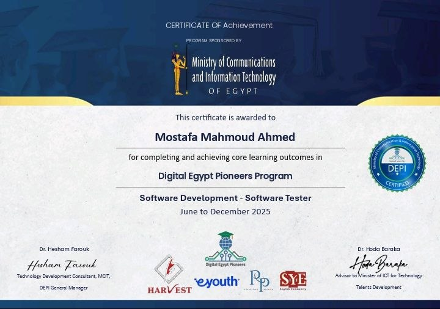
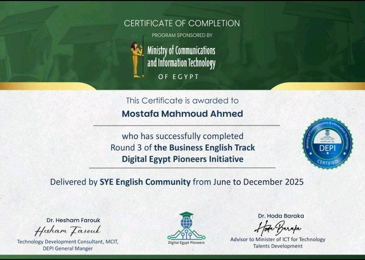

  

  

  
  
  

## Featured: Sufra

<b>What I built and why it matters</b> (click to expand)

 

- AI food-photo analysis and an Egyptian-Arabic AI coach, both served through serverless workers so no API keys ship inside the app
- System design: offline-first logging with a local sync queue, Firestore per-user security rules, auth-aware routing, free-tier cost ceilings
- Security: HTTPS-only networking, no credentials in local storage or logs, request timeouts and duplicate-tap guards
- Full RTL Arabic/English UI, glass design system, hand-built animations, unit/widget/golden-tested

Source is private. The [case study](https://github.com/mostafa-ghonime/sufra-showcase) has the full write-up.

## How I build

- **Production first.** Every component I ship is judged by what it does for the client and the end user, not by how it looks sitting in a repo.
- **AI as leverage.** I build with AI tools every day as a force multiplier, and I hold their output to the same bar as hand-written code: reviewed, tested, secured.
- **Evidence over claims.** Golden-tested UI, per-user security rules, offline-first sync, and a public [case study](https://github.com/mostafa-ghonime/sufra-showcase) that documents the real engineering decisions behind Sufra.

## Toolbox

  

<b>Engineering focus</b> (click to expand)

 

- Architecture: Clean Architecture, MVVM, feature-first modular structure, SOLID
- State management: BLoC/Cubit, Coroutines and Flow
- Android: Kotlin
- Cross-platform: Flutter and Dart
- Backend and services: Firebase (Auth, Firestore, Messaging), REST APIs, serverless Cloudflare Workers
- AI in production: LLM chat and vision-model pipelines behind serverless gateways, model evaluation for Arabic dialect quality
- System design: offline-first data flows, auth-aware navigation, security hardening, zero-cost-ceiling infrastructure
- Quality: unit, widget and golden rendering tests, structured error handling, performance optimization
- Workflow: Git, code review, technical documentation

<b>Full stack list</b> (click to expand)

 

  
  
  
  
  
  
  
  
  

## Certified: Digital Egypt Pioneers

  

  
  

<b>What these rounds covered</b> (click to expand)

 

- **Software Development, Software Tester track (Round 3, Jun-Dec 2025):** testing discipline applied to real software delivery: test design, manual and structured QA, graduation project defended in December 2025.
- **Business English Track (Round 3, Jun-Dec 2025):** professional English for client communication, delivered by SYE English Community.
- **Round 5 (in progress), Software Development, Cross Platform Mobile App Developer track:** Prompt Engineering, Dart Fundamentals for Flutter, Flutter Fundamentals, Flutter Advanced Topics, Firebase, UX/UI Basics, Git and GitHub, Functional Documentation and Unit Testing, Mobile Deployment for Android and iOS, and a Capstone Project.
- **Round 5 engineering growth:** architecture, testing, performance, security and CI/CD, applied to production-ready apps, reusable packages and technical case studies. Skills demonstrated: Flutter, Dart, REST APIs, JSON parsing, software architecture, dependency injection, testing, CI/CD and error handling.
- **Round 5 capstone, Sufra, an advanced nutrition application:** feature-based architecture, localization with Arabic RTL and English LTR support, a notification system, reusable UI components, state management, API and backend integration, performance optimization, integration testing, technical documentation and cross-feature integration.

## Currently

Going deeper on Flutter advanced topics, Firebase, AI integration patterns and scalable app design, through the current DEPI round.
