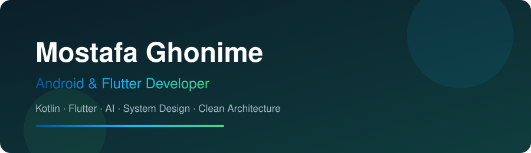

  

  
  

## About

Mobile developer from Egypt building Android and cross-platform apps with Kotlin and Flutter. I care about clean architecture, smooth UI and apps that hold up in production.

- Architecture: Clean Architecture, MVVM, SOLID
- Android: Kotlin, Jetpack Compose, Coroutines and Flow
- Cross-platform: Flutter and Dart, Kotlin Multiplatform
- Backend and services: Firebase (Auth, Firestore, Messaging), REST APIs, Cloudflare Workers
- Workflow: Git, CI/CD, code review, agile teams

## Featured work

**Sufra (سفرة)**: an Arabic-first nutrition companion built with Flutter and Firebase. Meal logging with search, barcode and photo analysis, water and weight tracking, meal planning, reminders, a coaching section, PDF reports, light and dark themes, full RTL and Arabic/English support. Delivered to a client. Source is private; see the [Sufra case study](https://github.com/mostafaghonime1-Nda/sufra-showcase).

**NutriVision**: AI-driven dietary health assistant built with Flutter. [Repository](https://github.com/NutriVision-Team/NutriVision)

## Tech stack

  
  
  
  
  
  
  
  
  

## Currently

Going deeper on Kotlin Multiplatform, Jetpack Compose and scalable app design.
